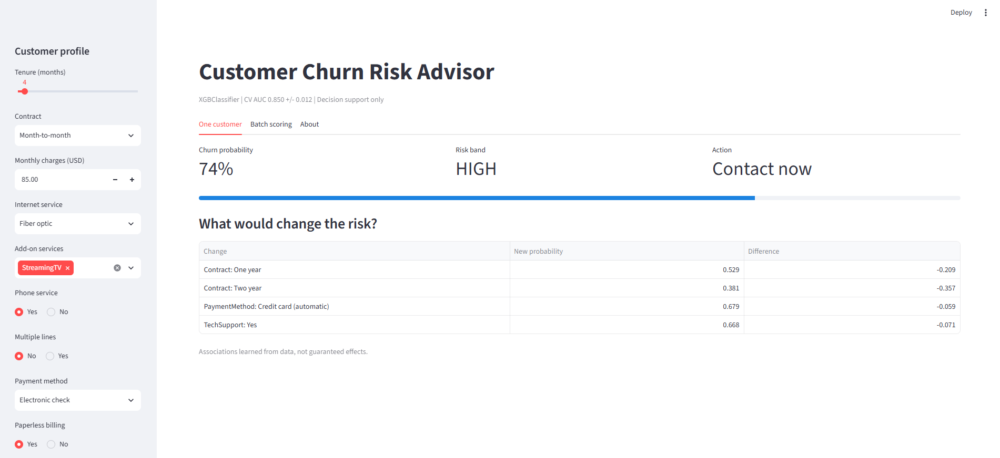
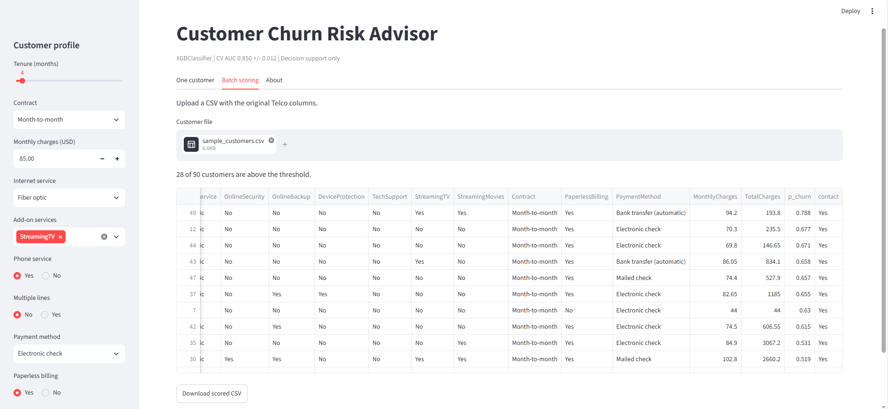

# Churn Risk Advisor

A Streamlit app that ranks telecom customers by churn risk, shows what-if changes, and scores customer files in batch. Project 1, Introduction to Applied AI (Week 4).

## Model card: Churn Risk Advisor v1.0

**Intended use:** rank existing telecom customers by churn risk so a retention team can prioritize calls. Decision support, not automation.

**Not for:** credit, pricing, or any decision that denies a service.

**Data:** IBM Telco Customer Churn, 7,043 customers, 26.5% churn.

**Model:** XGBoost (XGBClassifier), chosen by 5-fold CV. Features: 30 encoded columns.

**Performance:** CV AUC 0.850 +/- 0.012; test AUC 0.848 (test set used once).

**Threshold:** 0.20, from a cost analysis (FN = PKR 6,000, FP = PKR 1,000).

**Limitations:** one US dataset from one period; no Pakistan data; associations, not causes; performance may drift as plans change.

**Fairness check (Week 15):** compare recall across gender and seniors. 

**Owner and version:** Muhammad Luqman Khan, v1.0, October 10, 2026.

## Live app

https://churn-risk-advisor-luqmankhanlohani.streamlit.app/

## Screenshots

One customer:



Batch scoring:



## Run locally

Requires Python 3.12 or newer (xgboost 3.4.1 does not support Python 3.11).

```
python -m venv .venv
.venv\Scripts\activate          # Windows (Mac/Linux: source .venv/bin/activate)
pip install -r requirements.txt
streamlit run app.py
```

Files: `app.py` (app), `churn_xgb.json` (trained model), `model_meta.json` (columns, threshold, versions, metrics), `requirements.txt` (pinned: scikit-learn 1.6.1, xgboost 3.4.1), `sample_customers.csv` (50 customers for the batch demo).

## Notebooks

Weeks 1 to 3: https://github.com/lohaaniiii-lgtm/applied-ai-project1-churn

## Check Your Understanding

**1. Why does `get_dummies(drop_first=True)` break predictions when scoring a single customer?**
With one row, only one category of each feature is present, so it is treated as the first one and dropped, and all its dummy columns become 0. The model reads that as the baseline (Month-to-month for Contract) and no error is raised. The same Two-year customer scored 0.136 instead of 0.012.

**2. What does the parity test compare, and why must it cover every training row rather than a few?**
It compares predictions on the training-time features with predictions on features built by the app's serving encoder. It must cover all 7,043 rows because skew can affect only some categories or rare combinations. My largest difference was 0.0.

**3. Should the model be loaded with `st.cache_resource` or `st.cache_data`? Why?**
`st.cache_resource`, because the model is an object that should be loaded once and shared. `st.cache_data` copies its return value on every call, which is slow and wrong for a model.

**4. Why does the app derive TotalCharges instead of asking the user to type it?**
TotalCharges is tenure times monthly charges, so asking for it invites inconsistent inputs, for example a total smaller than one month's charge. Deriving it keeps the input valid.

**5. Why must requirements.txt pin the exact scikit-learn version used in training?**
A saved model depends on the library's internals, so another version can fail to load or silently change predictions. Pinning the training version makes the server match the training environment.

**6. The what-if shows a two-year contract lowers risk from 0.79 to 0.27. Would offering one make the customer stay? How could a company find out?**
Not necessarily: the model learned an association, and customers who choose two-year contracts may already be more loyal. A company could run an A/B test, offering the contract to a random half of at-risk customers and comparing churn between the groups.
